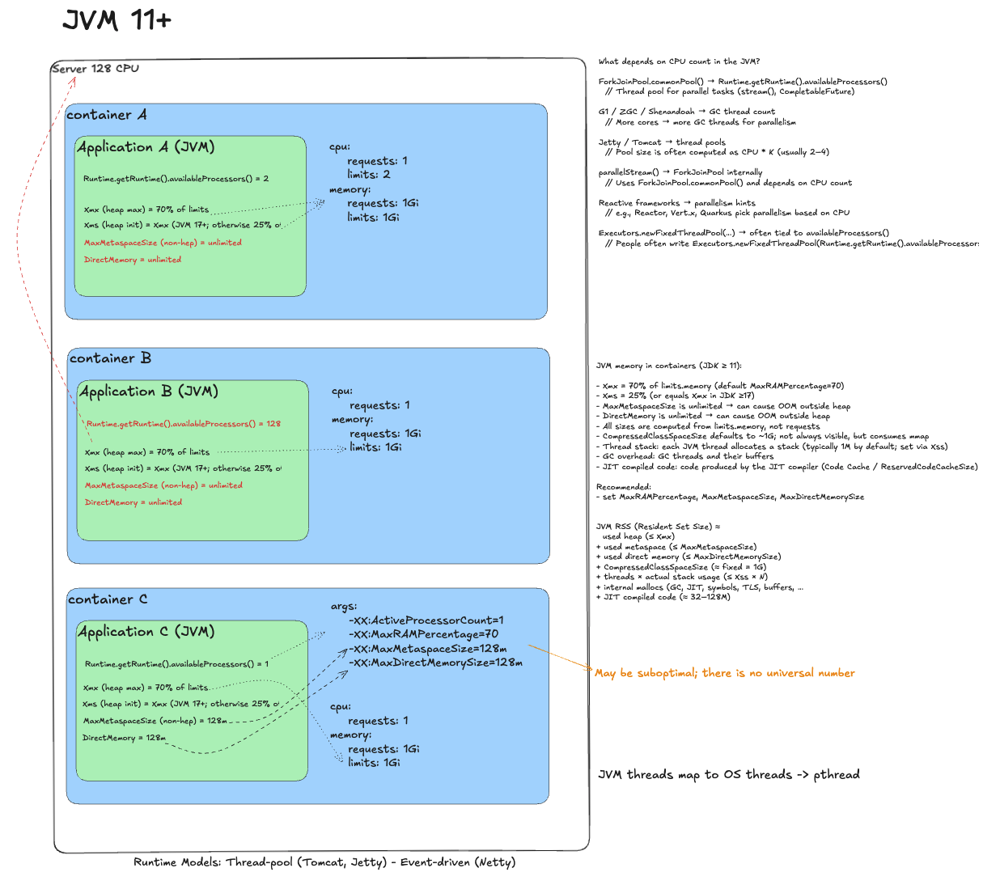
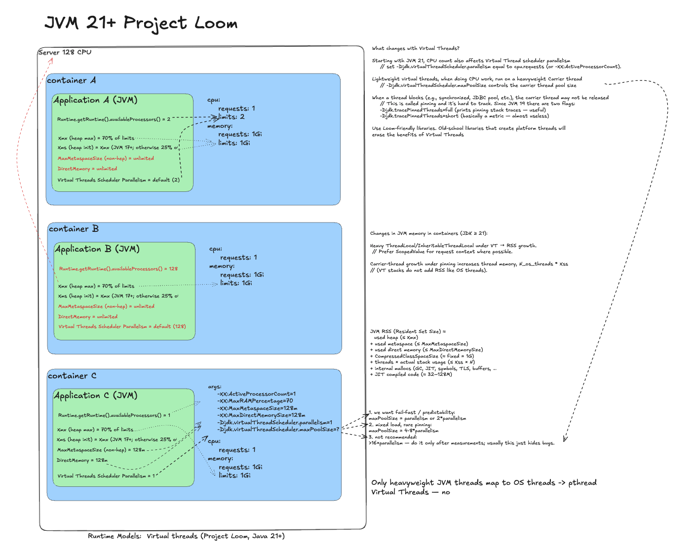
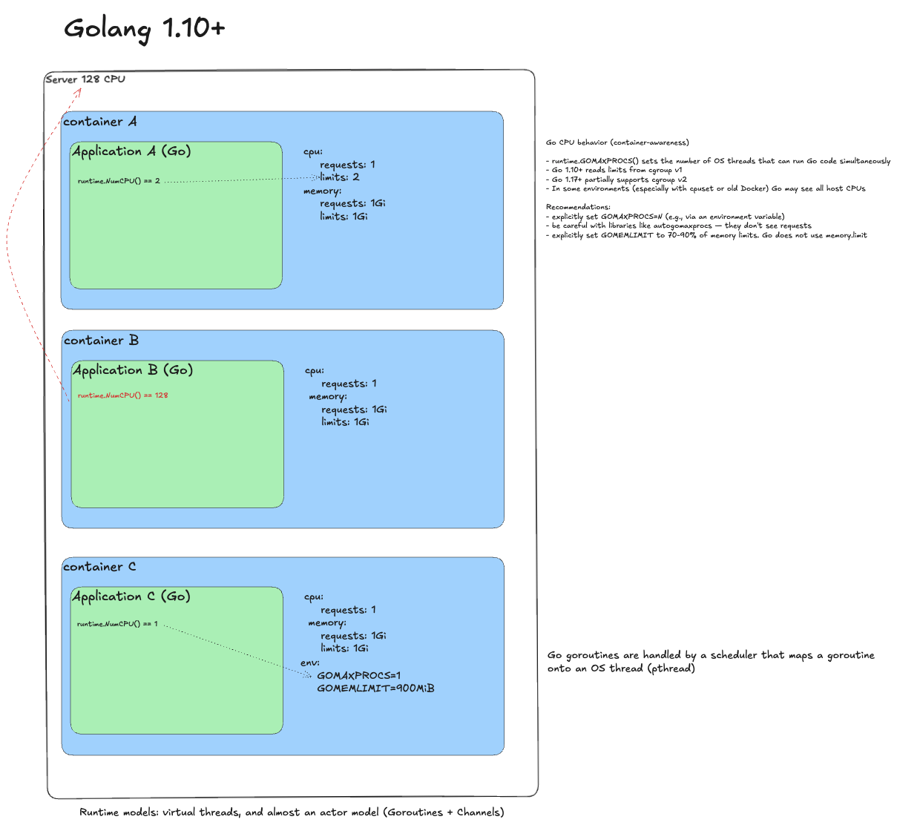
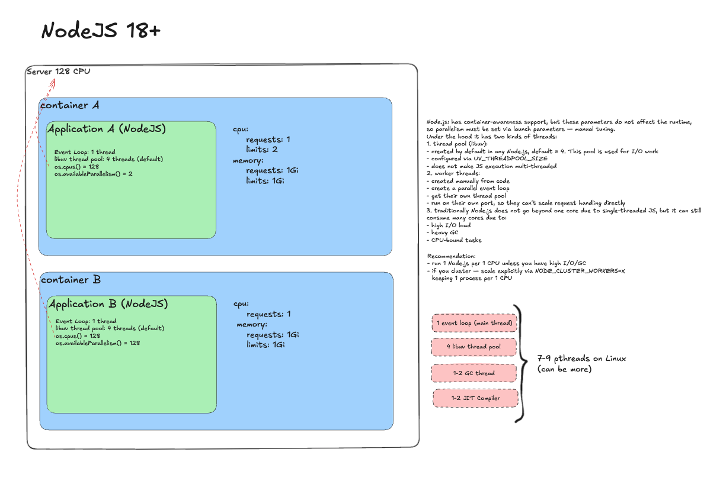
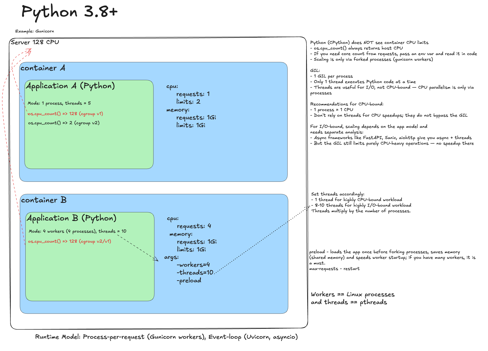
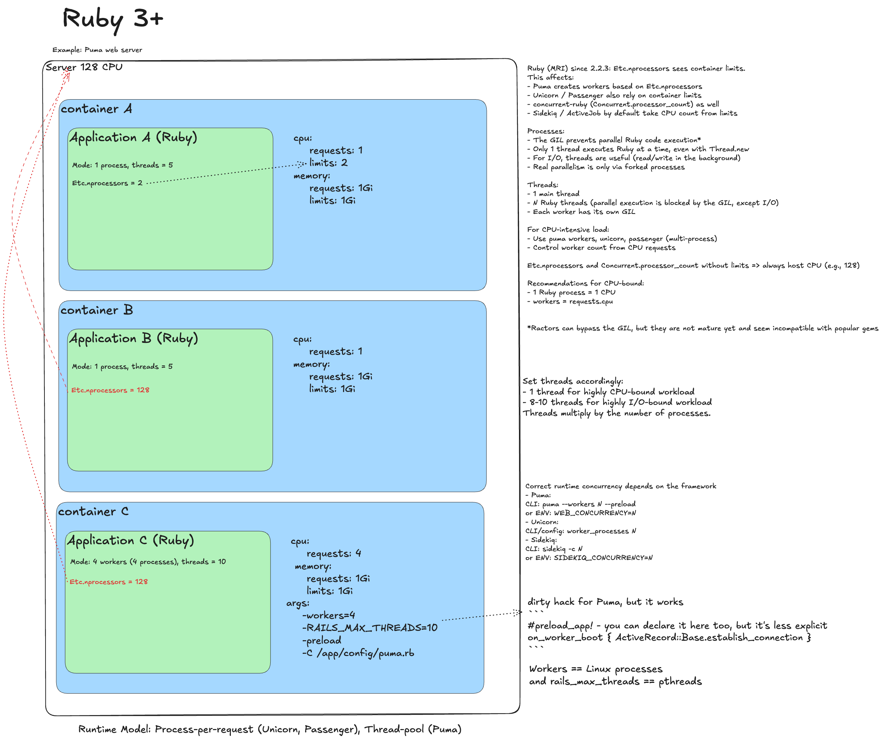
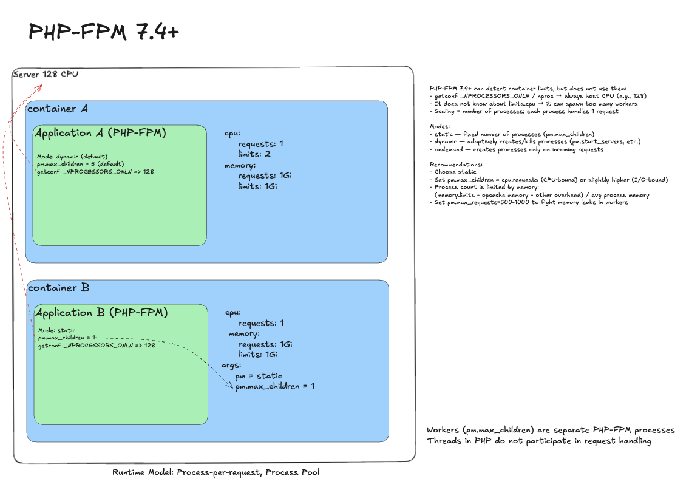
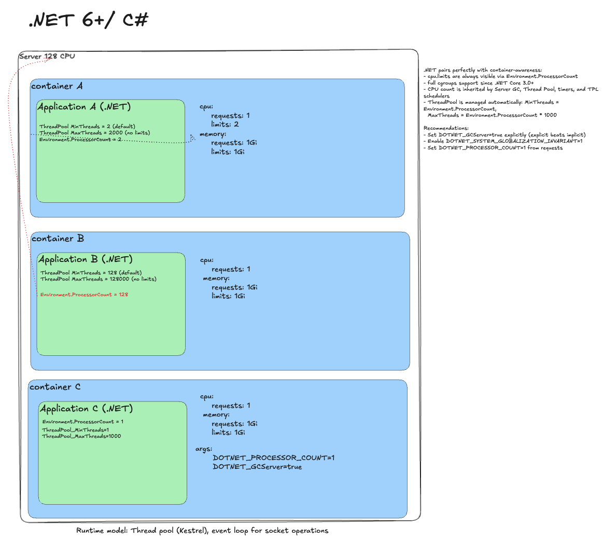

# Ideal application deployment

**The First Nine Guide. Block 4**

***

So, we finally built the ideal web application:

1. We reduced method complexity and function cost (block 1).
2. We picked the right runtime model for the workload (block 2).
3. We understood the internal architecture, which made the system resilient (block 3).

Now it's time to ship to production. And of course, into a container. Let's see what can go wrong. We'll also rate runtimes by how well they avoid traps on this path.

**How we will do it:** each runtime gets the same three container variants:

1) Naive - run as-is, no tuning. Typical problems show up.

2) Tuned - remove CPU limits (no quota: cpu.max = max) and keep base resources: no CFS throttling, less jitter.

3) Ideal - aligned requests/parallelism with memory limits.

On the right of each diagram I show thread behavior, parallelism, and mapping to heavy OS threads.

**Why remove CPU limits?**

- Simplified: the kernel artificially slows the process (CFS throttling). Latency spikes and short bursts starve for CPU.
- What stays: cpu.requests (Kubernetes target share) plus memory.requests and memory.limits.

(There will be a dedicated post, but feel free to argue in the comments.)

**When should limits stay?**

When CPU usage is uncontrolled and can eat the whole node. Limits are justified for untrusted code or shared clusters. A no-limits approach requires over-provisioned cpu.requests and careful monitoring. Test before removing limits.

***

## Java Virtual Machine 11+

I wrote a [post](https://t.me/r9yo11yp9e/14) (in Russian) about JVM tuning before; here is the short version.

**Naive deployment**

JVM sees a 2 CPU limit and sizes its parallelism accordingly: GC and ForkJoinPool. The Tomcat pool does not depend on CPU, it has 200 threads by default. The problem may look like this: throttling during warm-up, latency spikes, off-heap leaks.

**Remove throttling**

In container B we remove limits. Trap: without limits JVM assumes the whole node. availableProcessors() becomes 128 and the runtime spawns a massive number of threads. (On JDK 8, and on 11 and 17 before the October 2022 updates, JVM without a limit counted CPUs from requests and would return 1.) Context switching explodes and performance degrades. The app tries to use 128 cores with a 1 CPU guarantee.

**Ideal deployment**

Remove limits, but tell JVM the real budget. Set -XX:ActiveProcessorCount=1 (equals requests). JVM aligns its internal parallelism and avoids thread explosion. Also tune memory (-XX:MaxRAMPercentage, -XX:MaxMetaspaceSize) to avoid OOM killer.

***

## Java Virtual Machine 21+ (Virtual Threads)

Add a note on JVM with virtual threads.

**Naive deployment**

Same as JVM 11+: requests/limits and throttling. The virtual thread scheduler also sizes itself based on limits.

**Remove throttling**

Without limits the scheduler takes as many heavy threads as the node has cores, for example 128, with a 1 CPU guarantee. They fight for CPU, like the pools in JVM 11+.

**Ideal deployment**

Remove limits and do what we do in JVM 11+:

1. -XX:ActiveProcessorCount=1 - controls parallelism of GC, ForkJoinPool and the heavy thread pool for virtual threads.
2. -Djdk.virtualThreadScheduler.parallelism - needed only if you want a different number for virtual threads than in ActiveProcessorCount.

This aligns runtime parallelism with guaranteed resources.

***

## Go

**Naive deployment**

Run with requests and limits. Before Go 1.25 the runtime does not see limits: GOMAXPROCS equals the number of node cores, for example 128, and Go hits the quota. Since Go 1.25 (if go.mod says go 1.25 or newer) GOMAXPROCS defaults to the CPU limit, here it is 2. runtime.NumCPU() does not see the quota in any version. Issues: CPU throttling and GC not respecting container boundaries (OOMKill risk).

**Remove throttling**

Remove limits. Trap: without limits GOMAXPROCS equals the number of node cores, 128, on any Go version. Go can use up to 128 system threads at the same time with a 1 CPU guarantee. Performance degrades.

**Ideal deployment**

Set GOMAXPROCS=1 (from requests). Set GOMEMLIMIT to 70-90% of memory limit because Go ignores memory.limit. For automation, use automemlimit. The runtime respects container boundaries and behaves predictably.

***

## Node.js 18+/20+

**Naive deployment**

Requests 1, limits 2. Node's main thread is single-threaded; libuv pool defaults to 4. Problems are minimal, except CPU throttling on CPU-bound workloads.

**Remove throttling**

Almost nothing happens. Node will not explode or try to use all cores. But you still do not get effective parallelism.

**Ideal deployment**

The right answer is scale-out. Keep process count aligned with requests. This yields predictable throughput and clarity.

***

## Python 3.8+ (Gunicorn / Uvicorn)

**Naive deployment**

The standard Python build has the GIL: only one thread runs bytecode at a time. The build without the GIL is officially supported since Python 3.14, but it is not the default. You can use multi-process pseudo-parallelism. Naive deployment is usually fine, but throttling can happen.

**Remove throttling**

Remove limits. Trap: C libraries (NumPy, Pandas, OpenCV) may see 128 cores and parallelize aggressively, creating resource contention.

**Ideal deployment**

- Gunicorn processes = requests.
- For risky libraries: OPENBLAS_NUM_THREADS=1 and similar limits.
- For long-lived workers: max-requests(+jitter), preload.

***

## Ruby 3+

**Naive deployment**

Single-threaded MRI runtime: even if there are several threads, only one of them runs Ruby code at any moment, and the runtime switches between them. Same throttling risks, but usually acceptable.

**Remove throttling**

Remove limits. Puma itself does not count cores: by default it runs one process. The trap is in auto-tuning: WEB_CONCURRENCY=auto takes the worker count from Concurrent.available_processor_count. With a limit this is the quota, without a limit it is all node cores, and Puma will spawn too many processes.

**Ideal deployment**

Set it explicitly:

- WEB_CONCURRENCY=1 (from requests) - worker processes.
- RAILS_MAX_THREADS=5 - thread pool size per worker: more for I/O-bound, fewer for CPU-bound.
- For Unicorn and Sidekiq, set worker/worker concurrency explicitly as well.

***

## PHP-FPM 7.4+

**Naive deployment**

PHP-FPM runs in dynamic mode by default, creating and removing child processes as needed (process-per-request). Heavy apps hit limits and suffer. Dynamic mode (pm=dynamic) also causes memory spikes and unpredictability.

**Remove throttling**

Remove limits. PHP-FPM itself does not explode. Trap: if a library queries CPU via getconf _NPROCESSORS_ONLN, it will see all 128 cores.

**Ideal deployment**

- Process manager: pm = static.
- Worker count: pm.max_children = 1 (equals cpu.requests).

This yields stable and predictable behavior. PHP-FPM is harder to instrument due to its short-lived runtime, but Roadrunner or FrankenPHP can help.

***

## .NET 6+

**Naive deployment**

.NET is container-aware: it sees a 2 CPU limit and sizes ThreadPool and GC accordingly. Throttling can still happen.

**Remove throttling**

Remove limits. Trap: .NET sees all host cores and inflates ThreadPool. You get a 1 CPU guarantee but plan for 128.

**Ideal deployment**

Tune runtime to requests:

- DOTNET_PROCESSOR_COUNT=1 - inherited by all pools.
- DOTNET_gcServer=1 - server GC for predictable throughput (not always required, but reduces uncertainty).

***

I once tried to build a subjective runtime score table. Now I believe it is impossible to do objectively. So I dropped it and focus on traps and recommendations instead.

***

I will keep updating this article as a living cheat sheet. If you spot issues or gaps, leave comments.

> Next: we finally define what a "heavy thread" is and how to live with it.
>
> Previous: **[web server internals](inner-architecture.md)**.

Follow the channel [@r9yo11yp9e](https://t.me/r9yo11yp9e) - we will keep chasing the nines.
